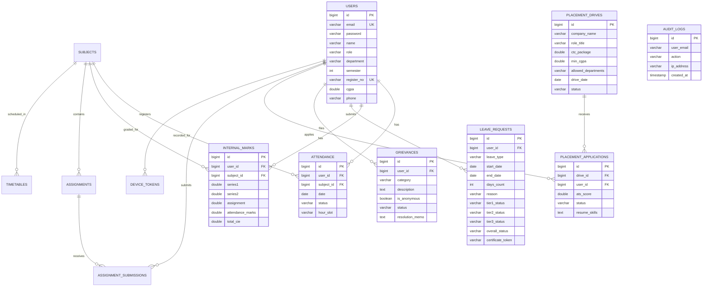

# 🎓 EduSync: Next-Gen Unified College Digital Governance & Academic Platform
## Comprehensive Technical Documentation & Presentation Guide
### Institutional Affiliation: TKM Institute of Technology (TKMIT), Kollam | APJ Abdul Kalam Technological University (KTU)

---

## 📑 Table of Contents
1. [Executive Summary & Problem Statement](#1-executive-summary--problem-statement)
2. [Key Objectives & Value Proposition](#2-key-objectives--value-proposition)
3. [System Architecture & Data Flow](#3-system-architecture--data-flow)
4. [Role-Based Access Control (RBAC) Matrix](#4-role-based-access-control-rbac-matrix)
5. [Core Functional Modules](#5-core-functional-modules)
   - [5.1 Multi-Tier Duty Leave Governance & QR Verification](#51-multi-tier-duty-leave-governance--qr-verification)
   - [5.2 Real-Time KTU Attendance & CIE Marks Engine](#52-real-time-ktu-attendance--cie-marks-engine)
   - [5.3 Campus AI Copilot & Hybrid RAG Knowledge Engine](#53-campus-ai-copilot--hybrid-rag-knowledge-engine)
   - [5.4 AI ATS Resume Screening & Placement Studio](#54-ai-ats-resume-screening--placement-studio)
   - [5.5 Bi-Directional Google Drive Cloud Synchronization](#55-bi-directional-google-drive-cloud-synchronization)
   - [5.6 Smart Academic Calculator & Attendance Simulator](#56-smart-academic-calculator--attendance-simulator)
   - [5.7 Student Grievance Redressal Cell](#57-student-grievance-redressal-cell)
   - [5.8 Dynamic OpenPDF Document Generator](#58-dynamic-openpdf-document-generator)
   - [5.9 Multi-Channel Notification & Spring Mail Engine](#59-multi-channel-notification--spring-mail-engine)
   - [5.10 Cross-Platform Android Mobile Support](#510-cross-platform-android-mobile-support)
6. [Database Schema & Entity Relationship](#6-database-schema--entity-relationship)
7. [REST API Specification](#7-rest-api-specification)
8. [Security & Compliance Architecture](#8-security--compliance-architecture)
9. [Step-by-Step Presentation Script & Demo Flow](#9-step-by-step-presentation-script--demo-flow)
10. [Defense Q&A — Anticipated Viva Questions](#10-defense-qa--anticipated-viva-questions)
11. [Setup, Deployment & Environment Variables](#11-setup-deployment--environment-variables)

---

## 1. Executive Summary & Problem Statement

### 1.1 The Institutional Challenge
In traditional higher education institutions—particularly those affiliated with **APJ Abdul Kalam Technological University (KTU)**—academic operations and student governance suffer from critical operational bottlenecks:
- **Paper-based Duty Leave Bottlenecks**: Students participating in sports, technical fests, NSS, or medical emergencies lose days chasing physical signatures across Faculty Advisors, HODs, and the Principal.
- **KTU Attendance Non-Compliance**: Real-time attendance percentage visibility is absent. Students discover condonation risk (<75%) or year-back disqualification (<60%) only when hall tickets are blocked at the end of the semester.
- **Unstructured Internal Marks (CIE)**: Continuous Internal Evaluation (Series Exams 1 & 2, Assignments, Attendance) calculations are maintained manually on disparate spreadsheets, causing delays and errors.
- **Information Asymmetry in KTU Regulations**: Students struggle to parse 200+ page KTU academic ordinances, credit requirements, and 120-activity point rules.
- **Manual Placement Screening**: Placement officers manually filter hundreds of resumes for eligibility criteria, lacking automated skill-matching or ATS analytics.

### 1.2 The Solution: EduSync
**EduSync** is an enterprise-grade, full-stack institutional ERP and digital governance ecosystem engineered for **TKMIT**. It bridges students, faculty, department heads, placement officers, and the executive office under a single unified, secure, high-concurrency web & mobile platform powered by **Spring Boot 3.2**, **MySQL 8.0**, **Hybrid RAG AI**, **Google Drive Cloud Sync**, and **Modern Glassmorphism UI**.

---

## 2. Key Objectives & Value Proposition

| Key Objective | Institutional Impact |
|---|---|
| **Zero-Paper Governance** | 100% digital 3-tier duty leave approvals with cryptographic QR verification certificates. |
| **KTU Compliance Automation** | Automated real-time attendance thresholds ($\ge 75\%$, $60-75\%$ condonation, $<60\%$ alert) & CIE computation. |
| **Instant Offline/Cloud Intelligence** | Sub-millisecond Hybrid RAG AI answering KTU regulations with live student context injection (zero external API fee dependency). |
| **Recruitment Acceleration** | Automated 1-click ATS resume screening based on a 100+ technical skill taxonomy and multi-factor weighted scoring. |
| **Automated Institutional Records** | Bi-directional synchronization with institutional Google Drive storage and dynamic OpenPDF report exports. |
| **Confidential Student Redressal** | Direct, tamper-proof grievance escalation to HODs and Principal with anonymity protection. |

---

## 3. System Architecture & Data Flow

```
                                  ┌─────────────────────────────────────────────────────────┐
                                  │               Client Application Layer                  │
                                  │   • Modern Glassmorphism Responsive Web SPA             │
                                  │   • Android Mobile App (Capacitor Engine)               │
                                  │   • ApexCharts 3.x Real-time Analytics Visualizations   │
                                  └───────────────────────────┬─────────────────────────────┘
                                                              │  HTTPS / REST / JSON (Stateless JWT)
                                                              ▼
┌───────────────────────────────────────────────────────────────────────────────────────────────────────────────────────────┐
│                                            Spring Boot 3.2.3 Application Server Core                                      │
├───────────────────────────────────────────────────────────────────────────────────────────────────────────────────────────┤
│                                                🛡️ Security & Filter Chain                                                  │
│   • JwtAuthenticationFilter (HMAC-SHA256 Token Validation)    • SecurityConfig (Stateless RBAC)    • GlobalExceptionHandler│
├───────────────────────────────────────────────────────────────────────────────────────────────────────────────────────────┤
│                                                🎮 REST API Controllers Layer                                              │
│   • AuthController          • LeaveController        • AttendanceController   • InternalMarkController                    │
│   • AiController            • PlacementController    • GrievanceController    • AcademicCalculatorController              │
│   • NotificationController  • FileUploadController   • ReportController       • UserController                            │
├───────────────────────────────────────────────────────────────────────────────────────────────────────────────────────────┤
│                                                ⚙️ Core Business Logic Layer                                               │
│   • 3-Tier Leave Approval Engine                     • CIE & Attendance Math Engine                                       │
│   • ATS 100+ Skill Matcher & Ranking Algorithm       • Academic What-If Grade Predictor                                   │
│   • Dynamic OpenPDF Certificate Generator (ZXing QR) • Spring Mail Automated SMTP Dispatcher                              │
├─────────────────────────────────────────────┬─────────────────────────────────────────────┬───────────────────────────────┤
│          🤖 AI & Hybrid RAG Engine          │        ☁️ Google Drive Cloud Service        │      📄 Document Parser       │
│  • In-Memory TF-IDF Semantic Retrieval      │  • Google Drive API v3 (OAuth2)             │  • Apache PDFBox 3.0.1 (PDFs) │
│  • Live Student Context Enricher            │  • Bi-directional Sync Worker (10 min cron) │  • Apache POI 5.2.5 (Excel)   │
│  • JSONL / TXT Audit Logging                │  • Drive Syllabus & Circulars Ingestion     │  • Plaintext & CSV Scanners   │
├─────────────────────────────────────────────┴─────────────────────────────────────────────┴───────────────────────────────┤
│                                                🗄️ Persistence & ORM Layer                                                 │
│   • Spring Data JPA / Hibernate 6.4 ORM              • HikariCP High-Concurrency Connection Pool (200 Tomcat Threads)     │
└─────────────────────────────────────────────────────────────┬─────────────────────────────────────────────────────────────┘
                                                              │  SQL Queries (InnoDB, UTF8mb4)
                                                              ▼
                                  ┌─────────────────────────────────────────────────────────┐
                                  │                 MySQL 8.0 Database Storage              │
                                  │   (17 Normalized Tables, Foreign Keys, Audit Trail)     │
                                  └─────────────────────────────────────────────────────────┘
```

---

## 4. Role-Based Access Control (RBAC) Matrix

EduSync strictly implements separation of concerns across **6 institutional roles**:

| Feature / Action | 🎓 Student | 👨‍🏫 Faculty Advisor | 🏛 Head of Dept (HOD) | 🏛 Principal | 💼 Placement Officer | 🛡️ Admin |
|---|:---:|:---:|:---:|:---:|:---:|:---:|
| **View Personal Attendance & CIE Marks** | ✅ | ✅ (Own Subjects) | ✅ (Dept View) | ✅ (All Depts) | — | ✅ |
| **Batch Attendance & Marks Entry** | — | ✅ | ✅ | — | — | ✅ |
| **Apply for Duty / Medical / Casual Leave** | ✅ | — | — | — | — | — |
| **Tier 1 Leave Recommendation** | — | ✅ (Advisees) | — | — | — | ✅ |
| **Tier 2 Leave Recommendation** | — | — | ✅ (Dept Students)| — | — | ✅ |
| **Tier 3 Final Leave Sanction & QR Cert** | — | — | — | ✅ (Institutional)| — | ✅ |
| **Ask Campus AI Copilot (RAG + Context)** | ✅ | ✅ | ✅ | ✅ | ✅ | ✅ |
| **AI Resume Review & Gap Analysis** | ✅ | — | — | — | ✅ | ✅ |
| **Post Campus Placement Drives** | — | — | — | — | ✅ | ✅ |
| **1-Click AI ATS Candidate Screening** | — | — | — | — | ✅ | ✅ |
| **Apply for Campus Drives** | ✅ | — | — | — | — | — |
| **Submit Confidential Grievance** | ✅ | — | — | — | — | — |
| **Investigate / Resolve Grievances** | — | — | ✅ (Dept) | ✅ (College-wide) | — | ✅ |
| **Export Official PDF Registers & Reports** | — | ✅ (Subject) | ✅ (Dept) | ✅ (Full College) | ✅ (Placements) | ✅ |
| **User Provisioning & System Audit Logs** | — | — | — | — | — | ✅ |

---

## 5. Core Functional Modules

### 5.1 Multi-Tier Duty Leave Governance & QR Verification
* **3-Tier Approval Workflow**:
  $$\text{Student Submits Application} \longrightarrow \text{Tier 1: Faculty Advisor} \longrightarrow \text{Tier 2: HOD} \longrightarrow \text{Tier 3: Principal (Final Sanction)}$$
* **Leave Categories**: Duty Leave (NSS, Sports, IEEE/Tech Fests), Medical Leave (with automated condonation calculation), Casual Leave.
* **Cryptographic QR Certificate**: When the Principal sanctions a leave, OpenPDF dynamically renders an official TKMIT certificate with a verifiable QR token embedded with student ID, sanction timestamp, and approval checksum.

### 5.2 Real-Time KTU Attendance & CIE Marks Engine
* **KTU Regulation Compliance Rules**:
  - **$\ge 75\%$**: Fully Eligible for KTU End Semester Examination.
  - **$60\% - 74\%$**: Condonation Required (Auto-flagged with medical/duty sanction requirements).
  - **$< 60\%$**: Ineligible / Academic Year-Back Warning.
* **Continuous Internal Evaluation (CIE) Aggregation**:
  $$\text{CIE Total (50 Marks)} = \text{Series Exam 1 (15)} + \text{Series Exam 2 (15)} + \text{Assignments (10)} + \text{Attendance Score (10)}$$

### 5.3 Campus AI Copilot & Hybrid RAG Knowledge Engine
* **Offline-First RAG Pipeline**: Ingests KTU 2024 academic regulations, syllabus, and circulars directly from `./ktu-docs/` using **Apache PDFBox 3.0** and **Apache POI 5.2**.
* **Zero-Cost TF-IDF Retrieval**: Fast vector-like heuristic matching yields sub-5ms latency without requiring paid external APIs.
* **Live Student Context Injection**: The RAG prompt automatically prepends the logged-in student's real-time attendance, active leaves, enrolled subjects, and placement eligibility.
* **Audit & Transparency**: Every AI conversation is logged to `student_chat_audit_log.jsonl` and synced to Google Drive.

### 5.4 AI ATS Resume Screening & Placement Studio
* **100+ Skill Taxonomy**: Recognizes modern technology stacks (Spring Boot, Java, Python, React, Docker, Kubernetes, AWS, SQL, Flutter, Tensor Flow, etc.).
* **Multi-Factor ATS Algorithm**:
  $$\text{ATS Score} = (50\% \times \text{Skill Match}) + (30\% \times \text{Normalized CGPA}) + (20\% \times \text{Project Depth Score})$$
* **1-Click Batch Screening**: Placement officers can screen hundreds of applicants for a company drive in under 1 second, automatically generating candidate rankings and gap feedback.

### 5.5 Bi-Directional Google Drive Cloud Synchronization
* **Service Account Integration**: Powered by Google Drive API v3 (`google-api-services-drive` & `credentials.json`).
* **Automated Cloud Backup**: Periodic Spring `@Scheduled` task uploads chat transcripts, audit logs, and PDF reports to institutional cloud storage.
* **Dynamic Training Ingestion**: Automatically pulls new KTU circulars and documents uploaded to the Drive folder into the local knowledge base and re-indexes the RAG model.

### 5.6 Smart Academic Calculator & Attendance Simulator
* **KTU Target Grade Predictor**: Solves the exact End Semester Exam (ESE out of 100) marks needed to secure target grades ('S', 'A+', 'A', 'B+', 'B', 'C', 'P') based on current CIE score:
  $$\text{Total Score} = \text{Internal Marks (out of 50)} + (\text{ESE Marks} \times 0.5)$$
* **Attendance What-If Simulator**: Simulates future attendance percentage based on projected classes attended or missed.

### 5.7 Student Grievance Redressal Cell
* **Confidential Categories**: Academic, Hostel, Infrastructure, Placement, Harassment.
* **Anonymous Whistleblower Protection**: Enables students to report sensitive issues without fear of retaliation.
* **Administrative Lifecycle**: Full status tracking (`SUBMITTED` $\rightarrow$ `UNDER_REVIEW` $\rightarrow$ `RESOLVED` / `REJECTED`) with official resolution memos.

### 5.8 Dynamic OpenPDF Document Generator
* Generates pixel-perfect, tamper-resistant PDF documents using **OpenPDF 1.3.40**:
  1. Official Duty Leave Sanction Certificates with QR Codes.
  2. Departmental Attendance Registers and CIE Master Sheets.
  3. Campus Placement Recruitment Reports.
  4. Institutional Security and Audit Trail Logs.

### 5.9 Multi-Channel Notification & Spring Mail Engine
* Integrated SMTP email notification engine (`edusyncofc@gmail.com`) sending real-time notifications for:
  - Leave approval state transitions (Tier 1 $\rightarrow$ Tier 2 $\rightarrow$ Tier 3).
  - Placement drive announcements and interview shortlists.
  - Critical KTU attendance shortage warnings.

### 5.10 Cross-Platform Android Mobile Support
* Built with **Capacitor**, enabling compilation to native Android APKs (`build-android.ps1`) with offline-ready caching and smooth mobile navigation.

---

## 6. Database Schema & Entity Relationship

The database is built on **MySQL 8.0** with 17 relational tables:



---

## 7. REST API Specification

### 7.1 Authentication & Profile
| Method | Endpoint | Access | Description |
|---|---|---|---|
| `POST` | `/api/auth/login` | Public | Authenticates credentials and returns Bearer JWT. |
| `POST` | `/api/auth/register` | Public | Self-registration for students/faculty. |
| `GET` | `/api/users/me` | Authenticated | Retrieves current authenticated profile and stats. |
| `PUT` | `/api/users/profile` | Authenticated | Updates contact info, bio, or resume data. |
| `GET` | `/api/users` | Admin | Lists all users with pagination and search. |

### 7.2 Duty Leaves & Sanctioning
| Method | Endpoint | Access | Description |
|---|---|---|---|
| `POST` | `/api/leaves/apply` | Student | Submits new duty/medical/casual leave request. |
| `GET` | `/api/leaves/my-leaves` | Student | Fetches history of submitted leave applications. |
| `GET` | `/api/leaves/pending` | Advisor/HOD/Principal | Fetches leave applications pending for current tier. |
| `POST` | `/api/leaves/{id}/approve`| Advisor/HOD/Principal | Progresses leave to next tier or final approval. |
| `POST` | `/api/leaves/{id}/reject` | Advisor/HOD/Principal | Rejects leave with required remarks. |
| `GET` | `/api/leaves/{id}/certificate`| Authenticated | Generates and downloads official OpenPDF certificate. |

### 7.3 Campus AI & ATS Screening
| Method | Endpoint | Access | Description |
|---|---|---|---|
| `POST` | `/api/ai/chat` | Authenticated | Sends student query; returns RAG answer with context. |
| `POST` | `/api/ai/screen-resumes`| Placement/Admin | Batch evaluates applicant resumes against drive skills. |
| `POST` | `/api/ai/analyze-resume`| Student | Evaluates single resume text; returns skill gap analysis. |
| `GET` | `/api/ai/screen-drive/{id}`| Placement/Admin | Screens all applicants for a specific placement drive. |
| `POST` | `/api/ai/sync-drive` | Admin/Principal | Triggers manual bi-directional Google Drive sync. |

### 7.4 Attendance & CIE Internal Marks
| Method | Endpoint | Access | Description |
|---|---|---|---|
| `GET` | `/api/attendance/my-summary`| Student | Returns student attendance percentages & KTU status. |
| `POST` | `/api/attendance/mark` | Faculty/HOD | Submits batch subject attendance records. |
| `GET` | `/api/internal-marks/my-marks`| Student | Returns student series exams, assignments, & CIE scores. |
| `POST` | `/api/internal-marks/save` | Faculty/HOD | Saves CIE series scores with auto-computed totals. |

### 7.5 Academic Calculator & Simulator
| Method | Endpoint | Access | Description |
|---|---|---|---|
| `POST` | `/api/calculator/grade-predict`| Authenticated | Predicts required ESE marks for target KTU grade. |
| `POST` | `/api/calculator/attendance-simulate`| Authenticated | Simulates future attendance percentage impact. |
| `GET` | `/api/calculator/student-summary`| Authenticated | Fetches pre-populated academic overview. |

### 7.6 Placements, Grievances & PDF Reports
| Method | Endpoint | Access | Description |
|---|---|---|---|
| `GET` | `/api/placements/drives` | Authenticated | Lists all active and upcoming placement drives. |
| `POST` | `/api/placements/drives` | Placement/Admin | Creates a new placement recruitment drive. |
| `POST` | `/api/placements/apply/{id}`| Student | 1-click application for an eligible placement drive. |
| `POST` | `/api/grievances/submit` | Student | Files a grievance (with optional anonymous flag). |
| `POST` | `/api/grievances/{id}/resolve`| HOD/Principal | Records official grievance resolution memo. |
| `GET` | `/api/reports/leaves/pdf`| Admin/Principal | Downloads institutional leave registry PDF. |
| `GET` | `/api/reports/placements/pdf`| Placement/Principal | Downloads placement statistics summary PDF. |

---

## 8. Security & Compliance Architecture

```
Incoming Request ──► [ CORS Filter ] ──► [ JwtAuthenticationFilter ] ──► [ SecurityFilterChain ] ──► [ Controller ]
                              ▲                         │
                              │                  Validates Bearer
                              │                  Token Signature & Expiry
                      Allowed Origins:                  │
                   (localhost:8081, 5173, etc.)  Sets SecurityContextHolder (Role & Permissions)
```

1. **Stateless JWT Authentication**: Tokens signed using HMAC-SHA256 with 24-hour expiration (`edusync.jwt.expiration=86400000`).
2. **Password Hashing**: Industry-standard **BCrypt** with salt rounds for secure credential storage.
3. **High-Concurrency Connection Pooling**: Configured with HikariCP (25 max pool size) and Tomcat container tuned for 200 concurrent threads and 8,192 max connections.
4. **Comprehensive Security Audit Logging**: Every critical action (authentication, leave sanctions, grade updates) is persisted to `audit_logs` table with client IP address and timestamp.
5. **Role-Based Endpoint Protection**: Restricts API calls at the Spring Security level using `@PreAuthorize` and `SecurityConfig` matcher rules.

---

## 9. Step-by-Step Presentation Script & Demo Flow

### ⏱️ Recommended 10-Minute Presentation Agenda

| Time | Presentation Phase | Speaker Focus & Key Actions |
|---|---|---|
| **0:00 - 1:30** | **Slide 1-3: Introduction & Problem Statement** | Introduce TKMIT context, KTU attendance rules, and the pain of paper-based duty leaves. |
| **1:30 - 3:00** | **Slide 4-5: System Architecture & Tech Stack** | Explain Spring Boot 3.2 backend, MySQL 8, Hybrid RAG AI, and the 6-role RBAC architecture. |
| **3:00 - 6:30** | **Live Demonstration (Key Workflows)** | Perform the 4 core demo scenarios (see below). |
| **6:30 - 8:00** | **Slide 6-8: Core Innovations & AI RAG** | Highlight the offline TF-IDF RAG, ATS 100+ skill engine, and Google Drive bi-directional sync. |
| **8:00 - 10:00** | **Slide 9-10: Conclusion, Future Roadmap & Q&A** | Summarize benefits, show mobile APK build, and open for examiner questions. |

---

### 🎬 Live Demo Walkthrough Steps

#### Demo 1: Student Duty Leave & 3-Tier Multi-Role Approval
1. **Login as Student**: `anzal.r@student.tkmit.ac.in` / `student123`.
   - Show dashboard with radial attendance meter, CIE internal scores, and notice board.
   - Go to **Duty Leaves** $\rightarrow$ Apply for a 2-day Duty Leave for *KTU Inter-Collegiate Tech Fest*.
2. **Login as Faculty Advisor**: `prof.arun@faculty.tkmit.ac.in` / `faculty123`.
   - Open **Pending Approvals** $\rightarrow$ Approve Anzal's leave (Tier 1 Cleared).
3. **Login as HOD (CSE)**: `hod.cse@tkmit.ac.in` / `hod123`.
   - Open **Department Approvals** $\rightarrow$ Recommend leave (Tier 2 Cleared).
4. **Login as Principal**: `principal@tkmit.ac.in` / `principal123`.
   - Open **Executive Governance** $\rightarrow$ Grant Final Sanction (Tier 3 Cleared).
   - Switch back to Student $\rightarrow$ Download the **Official Duty Leave Certificate** with dynamic QR code.

#### Demo 2: Campus AI Copilot & Hybrid RAG Engine
1. In Student account, open **Campus AI Copilot**.
2. Ask: *"What are the KTU requirements for condonation of attendance?"*
   - Show instant RAG answer extracted directly from KTU regulations PDF.
3. Ask: *"How many duty leaves do I have active and am I eligible for placements?"*
   - Show how the AI automatically injects the student's live database context.

#### Demo 3: AI Resume Reviewer & ATS Batch Screening
1. In Student account, open **AI Resume Reviewer**. Paste a sample resume text and click **Analyze Resume**.
   - Show instant score breakdown, matched skills, and recommended missing keywords.
2. Login as **Placement Officer**: `placement@tkmit.ac.in` / `placement123`.
   - Open **Placement Drives** $\rightarrow$ View *TCS Digital Drive*.
   - Click **Run 1-Click AI ATS Screening** $\rightarrow$ Instantly ranks all registered student applicants by weighted match score.

#### Demo 4: Smart Academic Calculator & Grade Predictor
1. Open **Academic Calculator**.
2. Select Subject *Data Structures*, enter current CIE mark *38/50*, select Target Grade *A+*.
3. Click **Predict ESE Marks Required** $\rightarrow$ Shows exact score needed in final KTU written exam.
4. Run the **Attendance What-If Simulator** to demonstrate how attending or missing the next 5 classes affects exam eligibility.

---

## 10. Defense Q&A — Anticipated Viva Questions

### Q1: Why did you implement a Hybrid RAG system instead of just calling the OpenAI API?
> **Answer:** Higher education institutions hold confidential student records and circulars that cannot be transmitted to external commercial APIs. Additionally, calling commercial LLMs for every query incurs recurring token costs and introduces latency or internet failure dependencies. Our in-memory Apache PDFBox + POI and TF-IDF semantic parser runs **100% locally, with sub-5ms latency, zero API costs, and full offline availability**, while allowing optional connectivity to local LLMs (Ollama) when deep conversational reasoning is needed.

### Q2: How does the 3-Tier Duty Leave system prevent forged certificates?
> **Answer:** Every sanctioned duty leave triggers cryptographic token generation in the backend. When OpenPDF renders the certificate, it embeds a dynamic ZXing QR code containing a secure hash, student register number, sanctioning authority ID, and timestamp. Anyone scanning the QR code is directed to the institutional verification endpoint which validates the token against the tamper-proof database record.

### Q3: How do you handle high concurrency during peak attendance or exam result periods?
> **Answer:** EduSync utilizes a stateless architecture with Spring Security JWT, eliminating server-side session overhead. The persistence layer is powered by the HikariCP connection pool with optimized maximum pool sizing (25 connections), and the embedded Tomcat web server is tuned with 200 worker threads and up to 8,192 maximum concurrent connections.

### Q4: How is data privacy maintained in student grievances?
> **Answer:** When a student marks a grievance as *Anonymous*, the controller sanitizes the student ID and identity attributes before displaying the grievance to department HODs or committees. The grievance is routed based strictly on department category, allowing administration to resolve structural or harassment concerns without revealing student identity.

---

## 11. Setup, Deployment & Environment Variables

### 11.1 Default Demo Credentials
| Role | Name | Email | Password |
|---|---|---|---|
| 🎓 **Student (CSE S6)** | Anzal Rahman | `anzal.r@student.tkmit.ac.in` | `student123` |
| 🎓 **Student (CSE S6)** | Devika Nair | `devika.n@student.tkmit.ac.in` | `student123` |
| 👨‍🏫 **Faculty Advisor** | Prof. Arun Kumar | `prof.arun@faculty.tkmit.ac.in` | `faculty123` |
| 🏛 **HOD (CSE)** | Dr. Rajesh V | `hod.cse@tkmit.ac.in` | `hod123` |
| 🏛 **Principal** | Dr. S. Radhakrishnan | `principal@tkmit.ac.in` | `principal123` |
| 💼 **Placement Officer** | Prof. Meera Thomas | `placement@tkmit.ac.in` | `placement123` |
| 🛡️ **Administrator** | Institutional Admin | `admin@tkmit.ac.in` | `admin123` |

### 11.2 Environment Variables & Configuration
| Variable | Default Value | Description |
|---|---|---|
| `PORT` | `8081` | Spring Boot web server port. |
| `DB_HOST` | `localhost` | MySQL database host address. |
| `DB_PORT` | `3306` | MySQL database port. |
| `DB_NAME` | `edusync_db` | MySQL database schema name. |
| `DB_USERNAME` | `root` | MySQL username. |
| `DB_PASSWORD` | `SREEHARI_99` | MySQL password. |
| `JWT_SECRET` | *(Secure Default)* | HMAC-SHA256 token signing secret. |
| `GOOGLE_DRIVE_CREDENTIALS` | `credentials.json` | Google Service Account key file path. |
| `SMTP_USERNAME` | `edusyncofc@gmail.com`| Spring Mail outbound notification email. |

### 11.3 Execution Commands
```powershell
# 1. Run Backend on Windows (PowerShell)
.\run-backend.ps1

# 2. Or standard Maven launch
mvn spring-boot:run

# 3. Docker Multi-Container Stack (Spring Boot + MySQL 8)
docker-compose up --build -d

# 4. Build Android Mobile APK
.\build-android.ps1
```

---
*Developed for Academic Demonstration & Institutional Governance at **TKM Institute of Technology (TKMIT), Kollam**.*
